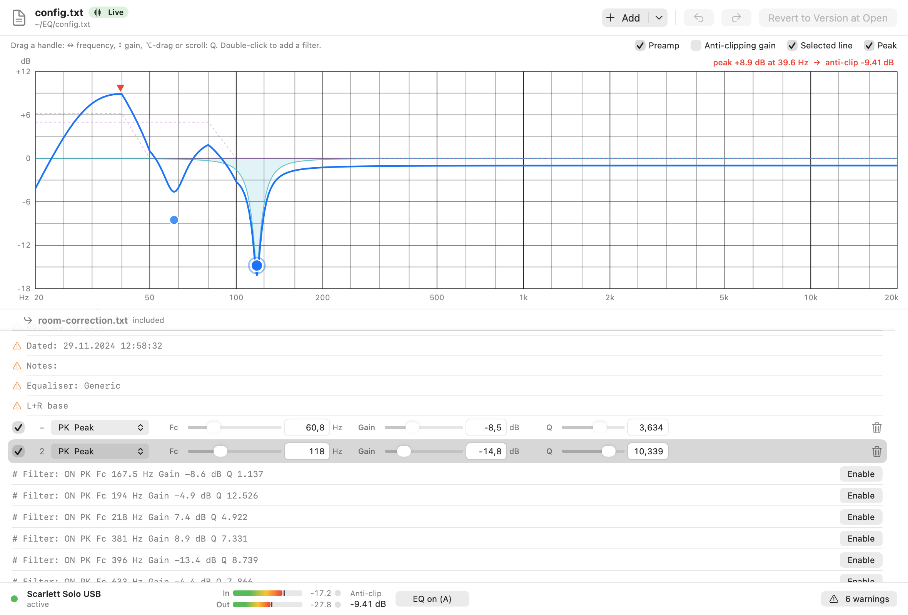

# EQ Ape

EQ Ape is a menu bar equalizer for macOS that processes all system audio going to your output device, without installing a virtual audio driver. It reads Equalizer APO-style configuration files, so existing parametric EQ and room-correction text files (including REW exports) can be loaded directly.

## Status

Early beta, built in one evening. What has and has not been checked:

- **Measured and tested:** the tap engine (tap, aggregate device, in-place processing, replay to the same device) was measured on a Scarlett Solo USB and on MacBook Pro Speakers: real audio, processing applied, no overloads or timestamp discontinuities, about 23-24 ms added delay. The DSP and config parser are covered by automated tests (`EQCore`, including a parity audit against Equalizer APO's documented behaviour).
- **Confirmed by ear on one setup:** on a Scarlett Solo USB the first menu-bar build engaged after the permission prompt, sounded correct, and the original, unprocessed sound was muted (no doubling). There is no measurable proxy for muting, so every other device type still needs the same listening check.
- **Tested headless only:** the app logic (per-device profiles, following the default output, live config reload, sample-rate change, a 5-minute soak, recovery after `kill -9`) was exercised through the app's headless mode. See `docs/APP-NOTES.md` for the numbers.
- **GUI:** the configuration editor and settings window were rendered offscreen and inspected, and the real GUI was launched with `--no-engine` (no audio engine) and driven in-process by a scripted smoke test (graph drag, GraphicEQ node drag/add/remove, live save, undo). It has not yet been used by a person with the engine running. See `docs/EDITOR-NOTES.md`.
- **Unverified:** Bluetooth, AirPlay and HDMI outputs; unplug/replug and sleep/wake; runs longer than five minutes; whether the audio-capture permission survives updates of an unsigned build.

See `docs/APP-NOTES.md` for app-level status. See `docs/TAP-FINDINGS.md` for the full list of what was and was not verified for the tap engine.

## The editor

"Open Editor…" in the menu opens a configuration editor in the spirit of Equalizer APO's Configuration Editor:

- A frequency-response graph of the whole config, drawn separately for left and right when they differ. It includes
  high- and low-pass filters, the GraphicEQ curve, and optionally the preamp and the automatic anti-clipping gain. It
  marks the peak that sets the anti-clipping gain and has a hover read-out.
- Automatic anti-clipping gain: the level is lowered by the largest boost of the whole chain (every filter, including
  high-pass and resonant filters, and the graphic EQ as it actually plays) plus a headroom you choose, so a steady
  full-scale tone stays below 0 dBFS. It cannot rule out clipping entirely: the EQ's phase shifts can raise short peaks
  of already loud music by a few dB, which the clip light shows.
- Draggable handles on the graph for peaking and shelf filters: horizontal = frequency, vertical = gain, ⌥-drag or
  scroll wheel = Q.
- A filter list with sliders and fields for each filter, the preamp, Channel sections, included files as collapsible
  sections, and "Enable" for REW's commented-out filters.
- GraphicEQ lines as in Equalizer APO's Graphic EQ: each row has its own graph of numbered nodes, a power toggle and a
  15-band / 31-band / variable choice. In variable mode nodes can be dragged sideways as well as up and down, added
  (double-click) and removed; the selected line's nodes can also be edited on the main graph. A sheet with vertical
  band sliders remains as an alternative view. "Add" offers variable, 15-band and 31-band graphic EQ lines.
- Live saving: changes are written to the file about 150 ms after you stop, and the engine reloads them, so you hear
  them while dragging. Only the lines you change are rewritten; everything else in the file stays byte for byte.
- Each file is backed up before its first change in a session (`~/Library/Application Support/EQ Ape/Backups`, last 20
  sessions kept).
- Undo/redo, "Revert to Version at Open", and an A/B bypass button.



Details, verification and known issues: `docs/EDITOR-NOTES.md`.

## Requirements

- macOS 14.2 or later
- Apple Silicon (arm64). There is no Intel or universal build.

## How it works

1. EQ Ape creates a Core Audio process tap of the chosen output device (excluding its own process) and mutes the original sound while the tap is read.
2. It applies your EQ to the tapped audio.
3. It plays the result to the same real device.

There is no virtual driver and no admin password: your real device stays the selected macOS output, so volume keys and output switching keep working. Capture and playback share the device's clock. The added delay measured in the proof of concept is about 23 ms. More detail is in `docs/ARCHITECTURE.md`.

## Permission and privacy

macOS asks for the **audio capture** permission the first time EQ Ape starts processing. It is needed because a process tap is the only way, short of a virtual driver, to receive the audio other apps send to an output device. It is not a microphone permission and EQ Ape does not record anything.

Audio is processed in memory only. It is not written to disk and not sent anywhere. The app makes no network connections: a search of the source (`App/`, `EQCore/`, `poc-tap/`) found no use of URLSession, the Network framework or sockets, and no update checker. The only external things it opens are local files and folders (your config files, its settings and backup folders) and the Privacy & Security pane of System Settings. You can audit this yourself in the source.

Warning for contributors and testers: an unanswered macOS permission prompt can stall new audio for every app on the Mac until it is answered. See `docs/ARCHITECTURE.md`.

## Equalizer APO config compatibility

Supported (the config files use Equalizer APO's format):

- `Preamp`
- `Filter` types PK (also PEQ, Modal), LSC, HSC, LS, HS, LP, HP, LPQ, HPQ, NO, AP, BP, with Equalizer APO's defaults (for example shelf slope, default Q) and `BW Oct`
- `GraphicEQ`
- `Channel` (stereo: L, R, 1, 2, ALL)
- `Include`
- `#` comments, decimal commas, UTF-8 and UTF-16 files

Not supported (lines using these are ignored with a warning): `Device:`, `Stage:`, `Copy:`, `Delay:`, `Convolution:`, `Eval:`, `If:`/`ElseIf:`/`Else:`/`EndIf:` (the lines inside an `If:` block are currently applied unconditionally), `LoudnessCorrection:`, `VSTPlugin:`, `Filter: ON IIR ...`. Channel handling assumes a stereo model. Details are in `docs/APO-PARITY.md`.

EQ Ape is not affiliated with, endorsed by or sponsored by the Equalizer APO project, and no code from Equalizer APO is used. Equalizer APO is a name of its respective owners.

## Installing

Download the DMG from the [GitHub Releases](https://github.com/Mukimies/eq-ape/releases) page of this repository once a release is available (the first one will be the pre-release `v0.1.0-beta.1`), open it and drag EQ Ape to Applications. Verify the download with the `.sha256` file: `shasum -a 256 -c EQ-Ape-<version>.dmg.sha256`.

A Homebrew tap (`brew install --cask Mukimies/tap/eq-ape`) is planned and does not exist yet. Even then the app arrives quarantined and the steps below still apply; see `docs/DISTRIBUTION.md`, section 8.

The first release is **not notarized** (there is no Apple Developer ID yet; it is ad-hoc signed). On current macOS (15 and later), Control-click > Open no longer bypasses Gatekeeper. Instead:

1. Double-click EQ Ape. macOS shows an alert that it cannot verify the app. Close it (do not move the app to the Trash).
2. Open System Settings > Privacy & Security, scroll to the Security section and click **Open Anyway** next to the EQ Ape message, then confirm.

Alternatively, `xattr -dr com.apple.quarantine "/Applications/EQ Ape.app"` removes the quarantine flag. The exact wording varies between macOS versions. An unsigned build will probably need the audio-capture permission granted again after each update. Building from source yourself avoids the quarantine step. See `docs/DISTRIBUTION.md`.

## Building from source

Requires a recent Xcode or Swift toolchain on an Apple Silicon Mac.

```sh
cd EQCore && swift test        # DSP and parser tests
cd poc-tap && ./build.sh       # command-line proof of concept, builds build/eqtap.app
cd App && ./bundle.sh          # builds "App/build/EQ Ape.app" (arm64, ad-hoc signed, not launched by the script)
cd App && BUILD_DIR=build-dev ./bundle.sh   # same, into App/build-dev (leaves a running build/ copy alone)
```

To try the GUI without any audio engine (no taps, no permission prompt): run
`"App/build-dev/EQ Ape.app/Contents/MacOS/EQApe" --no-engine --editor <a copy of your config>`.

For app-level instructions and notes see `docs/APP-NOTES.md`. Building does not start audio, but running the app or `eqtap` will trigger the audio-capture permission prompt.

## Licence

EQ Ape is released under Apache-2.0 with the Commons Clause (see `LICENSE`). You may use it for free, including at work, and read, modify and share it; you may not sell it, or a product or service whose value derives substantially from it. Because of the Commons Clause this is **source-available** software, not open source as the term is defined by the Open Source Initiative.

## Contributing

Contributions are welcome: bug reports (please include macOS version, output device and what the permission state was), test results on other devices, and pull requests. By contributing you agree that your contribution is licensed under the same terms as the project (Apache-2.0 with the Commons Clause). Do not copy code from GPL-licensed projects such as Equalizer APO.
