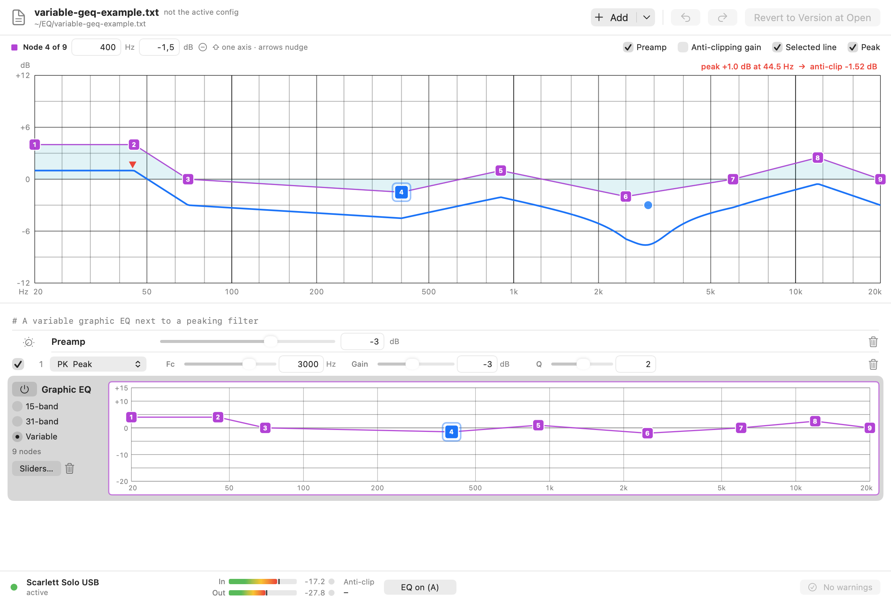

# Configuration editor and GUI notes

Date 2026-11-12. macOS 26.6.2, Apple Silicon, Swift 6.3.3. Screenshots: `docs/screenshots/` (rendered offscreen, see
"Verification").

EQ Ape's editor does what Equalizer APO's Configuration Editor does on Windows: it shows the frequency response of the
whole config and lets you change it while you listen. It edits the Equalizer APO text files themselves. Every change is
written about 150 ms later, and the running engine reloads the file about 0.35 s after that. Equalizer APO was used only
as a behavioural reference (its editor's screenshots and documentation). No code or assets were copied. Equalizer APO is
GPL; EQ Ape is source-available under Apache-2.0 with the Commons Clause.

## Design

### Document model (EQCore, additive public API)

- `ConfigLine.swift`: a single line-level interpreter (`LineInterpreter`) that both `APOParser` and the editor use.
  - `LineKind`: `blank`, `comment(command:)`, `command(ConfigCommand)` or `unknown(message:)`. For a comment, `command`
    is set when the text after `#` is itself a valid command (REW's commented-out filters). The `message` of an unknown
    line is exactly the warning `APOParser` emits.
  - `ConfigCommand`: `preamp`, `filter(FilterLine)`, `graphicEQ(points)`, `channel(names)` or `include(path)`.
  - `FilterLine` keeps the fields as written: label (filter number), ON/OFF, type name, Fc, Gain, Q, BW Oct and slope.
    It applies no defaults. `FilterLine.evaluate(line:)` builds the biquad and the warnings with exactly Equalizer APO's
    rules (moved unchanged out of the old `APOParser.parseFilter`).
  - `ConfigCommand.canonicalText` writes canonical, case-sensitive Equalizer APO syntax.
  - `APOFormat` gives the shortest round-trip number. A frequency never gets exactly three decimals: "60.812" would hit
    Equalizer APO's REW thousands-separator rule and be read as 60812 Hz, so it is written as "60.8120".
- `APOParser` now only adds channel selection, Include recursion and the `file:line:` prefixes on top of the
  interpreter. Its public API and behaviour are unchanged: the 29 existing tests pass unmodified.
- `ConfigDocument.swift`: a value type holding the encoding (UTF-8, UTF-8 with BOM, UTF-16 LE or BE with BOM) and an
  ordered list of lines. Each line keeps its text and its own terminator (`\n`, `\r\n`, `\r`, …). Lines are split
  exactly like the parser, so line numbers match its warnings.
  - Serialising an unmodified document is byte-exact. This is checked at load time: a file whose bytes cannot be
    reproduced from the decoded text (for example invalid UTF-8) is loaded `readOnly`. It is shown and evaluated, never
    edited.
  - Edits: `setCommand`, `setLineText`, `setCommented` (adds `# `, or removes `#` and the spaces after it, only when
    the comment is a valid command), `insertLine`/`insertCommand`/`appendCommand`, `removeLine` and `moveLine`.
  - An edit regenerates only its own line and keeps that line's terminator and leading indentation.
  - Structural edits keep the file's final-newline state and never move the final empty line.
- `ConfigWorkspace.swift`: the root file plus every included file, each as its own `ConfigDocument`, keyed by
  standardized URL.
  - `includeTree()` returns the tree, including missing files and cycles.
  - `evaluate()` returns the same `ParseResult` as `APOParser.parse(fileURL:)` would for the in-memory documents, and
    also where each stage and warning comes from (`LineRef`) and the channel selection at each line.
  - `edit(url, name, coalesceKey)` makes an undoable step. Consecutive edits with the same key merge into one step (a
    slider or handle drag) until `endCoalescing()`.
  - Also: `undo`/`redo`, `revertToOriginals()` (undoable), and `reloadFromDisk` (drops the undo history of that file).
  - New Include targets are loaded automatically after an edit.

### Live saving (EQApeCore)

- `ConfigEditSession` wraps a workspace.
  - It writes changed files 150 ms after the last edit, in place rather than by rename-over, which keeps the inode,
    permissions and extended attributes. The engine's watcher waits for the file to be stable for one poll before it
    reads.
  - Before the first write of each file in a session, `EditorBackups` copies the file to
    `~/Library/Application Support/EQ Ape/Backups/<yyyy-MM-dd_HH-mm-ss>/` with a `manifest.txt` of original paths.
    Only the newest 20 session folders are kept, and only folders with timestamp names are ever deleted.
  - It polls the files every 0.5 s. A file that changed on disk and differs from what the session wrote is reloaded.
    If the file had unsaved edits (only possible inside the 150 ms window), the user is asked.
- `ResponsePlot` computes the graph data.
  - The grid is 400 log-spaced points from 20 Hz to 20 kHz, plus the centre and band-edge frequencies of every biquad,
    so a Q 10 notch is drawn at its true depth.
  - Biquads use EQCore's exact magnitude, so high-pass, low-pass, notch, all-pass and band-pass are included. GraphicEQ
    uses its interpolated curve. Preamp can be included or excluded.
  - Anti-clipping uses the engine's own function (`EQProcessor.antiClipGainDB` / `Response.chainPeak`: every stage,
    1 Hz to just below Nyquist, GraphicEQ as the designed FIR plays it), so the plotted peak and gain are exactly the
    ones the engine applies. Until 2026-11-12 this was `Response.peak` (high-pass ignored); see the update below.
- `TapController` gained:
  - `setABBypass(_:)`: one lock-free slot swap to "no processor" (unity), and back to the retained EQ box. It takes
    effect from the next IO cycle. A rebuild while bypassed stays bypassed.
  - `watchSettingsFile()`: settings.json is re-read when it changes on disk.
  - `setProfile(uid:_:)`.
  - `settingsReadOnly`.

### GUI (EQApe target)

- Windows are AppKit `NSWindow`s hosting SwiftUI. They can be opened from a menu bar app and at launch.
  - Editor: autosaved frame `EQApeEditor`, so it is resizable and remembers its size.
  - Settings: autosaved frame `EQApeSettings`.
  - First run: shown only when there are no profiles, the first run has not been completed, and the engine is enabled.
    The owner already has profiles, so it will not appear for them.
- The graph is an `NSView` (`ResponseGraphNSView`).
  - Grid: lines at the 1/3-octave centres, labels at 20/50/100/200/500/1k/2k/5k/10k/20k. The dB axis auto-scales in
    6 dB steps, never smaller than ±12 dB, and does not rescale during a drag. The 0 dB line is stronger.
  - Curves: one combined curve, or blue Left and orange Right when they differ. The selected line's own curve is a
    teal fill; it is dashed when the line is OFF or commented out and shown as if enabled.
  - Peak marker, with "peak +x dB at f → anti-clip y dB" in the top margin.
  - Hover read-out: frequency, the curve value (L and R) and the cursor level.
  - Handles: active peaking and shelf filters, coloured by channel, hollow when OFF. Drag changes frequency
    horizontally and gain vertically; option-drag or the scroll wheel changes Q; double-click adds a filter. A click
    alone never rewrites a line: only the components that moved are rounded and written.
  - Recomputing the plot per drag step is synchronous and takes a few milliseconds.
- Filter list (SwiftUI `List`): one section per file in Include order. Sections can be collapsed and are indented by
  include depth. Blank lines are hidden.
  - Filter row: ON checkbox, filter number, type picker (PK, LSC, HSC, LS, HS, LP, HP, LPQ, HPQ, BP, NO, AP, plus
    PEQ/Modal/None when present), Fc (log slider and field), Gain, then Q, BW or slope (default shelves show slope
    10.8), a channel badge (L or R) and delete.
  - Preamp row with a slider.
  - Channel lines appear as "Applies to: L" headers.
  - Include rows (marked "not found" if missing).
  - Comments are dimmed, with an Enable button when the comment is a valid command.
  - Unknown lines are dimmed, with a warning icon and a tooltip.
  - Context menu: Comment Out, Enable, Turn On/Off, Delete. Drag to reorder (`onMove`, within a file). Delete key.
  - "Add Filter" adds after the selected line, otherwise in the file with the most filters.
- GraphicEQ (rows reworked 2026-11-12, see the update below): an inline node graph per row, the 15-band / 31-band /
  Variable choice and a power toggle on the row; nodes editable on the main graph too; the sheet ("Sliders…") with
  vertical band sliders remains as an alternative view. As first built:
  - The existing points are kept.
  - Add Band (geometric middle of the selected and next band), Remove Band.
  - Band Layout: 10 (octave), 15 (2/3 octave) or 31 (1/3 octave) bands. The current curve is resampled, not
    discarded. Flatten. (Replaced on 2026-11-12 by the Fixed 15 / Fixed 31 / Variable mode switch; the 10-band
    layout was dropped to mirror Equalizer APO's choices.)
  - Selected-band frequency and gain fields.
- Status strip: device and engine state, In and Out meters with peak hold and a clip light, the applied anti-clipping
  gain, the A/B bypass button, notices and save errors, and a warnings popover. Clicking a warning selects its line and
  scrolls to it.
- Undo and redo use toolbar buttons with ⌘Z and ⇧⌘Z. "Revert to Version at Open" is undoable.
- The menu bar menu is now:
  - EQ Ape On
  - device: state
  - Bypass (A/B)
  - (Reload, only in an error state such as "start blocked")
  - Open Editor… (⌘E)
  - Settings… (⌘,)
  - Quit
- Settings: every device profile (config path with Choose… and Edit…, Enabled, anti-clipping on/off, headroom
  stepper, Remove), a "Choose Config File…" entry for the current device if it has no profile, "Launch EQ Ape at login"
  (SMAppService, only when toggled), folder buttons, and a permission explanation with a button that opens System
  Settings › Privacy & Security at `Privacy_AudioCapture` (that anchor exists on this macOS; it falls back to
  `Privacy_ScreenCapture`).
- Launch flags (`LaunchOptions.swift`):

  | Flag | Effect |
  |---|---|
  | `--no-engine` | No engine, taps or device I/O. Device names are read only. Settings are read-only unless `--settings` is given. |
  | `--editor <path>` | Open the editor on that file. |
  | `--settings <file>` | Use this settings.json. |
  | `--backup-dir <dir>` | Write editor backups here. |
  | `--render-snapshots <dir>` | Render the views to PNG and exit; implies no engine. |
  | `--smoke-test` | Drive the editor in-process. |

  SIGTERM, SIGINT and SIGHUP flush pending editor saves, stop the controller and exit 0.
- Accessibility: every slider, field, toggle and button has a VoiceOver label (with a value where useful). The band
  sliders are focusable, respond to ↑/↓ in 0.5 dB steps, and support VoiceOver increment/decrement. Text fields are in
  the tab order. The graph exposes a summary value: peak, number of handles, and whether L and R differ.

## Verification

All of this was done without starting an audio engine, without opening or quitting anything in `App/build/`, without
playing sound, and without changing device settings.

**Automated tests**
- `EQCore`: 44 tests, 0 failures (29 existing + 15 new in `DocumentTests.swift`). The real-config test runs with
  `EQAPE_REAL_CONFIG` pointing at a scratch copy.
- `App`: 20 tests, 0 failures (13 existing, one of which is the real-config test run with `EQAPE_REAL_CONFIG`, + 6 in
  `EditorTests.swift` + 1 settings test).

The new tests cover:
- Byte-exact round trip on fixtures: LF, CRLF, no final newline, UTF-8 BOM with CRLF, UTF-16 LE, UTF-16 BE, mixed
  line endings, tabs and odd spacing, non-ASCII, empty, only-newline, and the REW style with commented filters and the
  `Filter  2: ON  PK       Fc   118.0 Hz  Gain -14.80 dB  Q 10.339` spacing. Invalid UTF-8 is read-only and still
  exact. The five files of the real config copy also round-trip byte-exact.
- Single-line edits change only that line's bytes, in every encoding and line-ending style.
- Canonical text reads back to the same fields, including the 3-decimal frequency guard.
- ON/OFF, Preamp, GraphicEQ, comment enable/disable, add/remove/reorder, and final-newline preservation.
- Include tree with a subfolder, backslashes, quotes, a missing file, UTF-16 and a cycle. Editing an included file
  changes only that document.
- Undo, redo, coalescing, revert, and no-op edits.
- Stage and warning equality with `APOParser` on 79 syntax snippets (every case in the parser and parity tests plus
  extras) and on all encoding fixtures.
- Backup creation, naming, manifest, pruning to 20 (an unrelated folder survives) and same-second sessions, in a temp
  directory.
- Debounced write: one write for 20 drag edits.
- External change and conflict handling.
- Live save picked up by EQApeCore's `FileWatcher` and `ConfigLoader` (no engine): the edited high-pass is read back
  with the expected stages, latency under 1.5 s.
- Plot numbers.
- settings.json re-read and read-only mode.

**Plotted curve vs EQCore**, real config copy, 48 kHz, preamp included, anti-clip excluded:

| Frequency | Plotted | Expected |
|---|---|---|
| 20 Hz | −4.16 dB | ≈ −4.2 dB with the high-pass (+10.09 dB without it, ≈ +10.1) |
| 40 Hz | +8.86 dB | ≈ +8.9 dB |
| 118 Hz | −16.15 dB | ≈ −16.2 dB |
| 200 Hz | −1.26 dB | |
| 500 Hz – 20 kHz | −1.00 dB | "0 dB above 200 Hz" |

- The brief's "0 dB above 200 Hz" holds only with Preamp excluded. With the −1 dB preamp included the flat part is
  −1.0 dB. Both are visible in the GUI: tick or untick "Preamp".
- Peak +10.19 dB at 5 Hz, so the anti-clipping gain was −10.69 dB, equal to the headless run in APP-NOTES. Since the
  2026-11-12 update: peak +8.91 dB at 39.6 Hz, gain −9.41 dB.

**Rendered offscreen and inspected** (`--render-snapshots`, NSHostingView in a borderless window that is never shown;
the PNGs are in `docs/screenshots/`):

| File | View |
|---|---|
| `editor-real-light.png`, `editor-real-dark.png` | Real config copy (neutral file names), 118 Hz cut selected |
| `editor-real-anticlip.png` | Anti-clipping gain included in the curve |
| `editor-stereo-light.png`, `editor-stereo-dark.png` | Different left and right channels |
| `editor-commented-light.png` | REW export with commented filters and an OFF filter |
| `graphiceq-editor-light.png`, `graphiceq-editor-dark.png` | GraphicEQ band editor |
| `warnings.png` | Warnings list |
| `settings-light.png`, `settings-dark.png` | Settings |
| `first-run-light.png` | First-run window |
| `editor-no-engine.png` | Real `--no-engine` status |

The "active" status, meter levels and the profiles in the Settings snapshots are preview data. Fixed after looking:
- In dark mode the header and options bar were white on white: the view had no window background of its own.
- The "dB" axis label overlapped "+12".
- The peak label covered the curve; it is now in the top margin.
- The selected row was scrolled out of view.
- Shelves with the default slope showed "Q 0"; they now show slope 10.8.
- L and R handles were not distinguishable; they are now coloured by channel.
- The no-engine state read "error: engine disabled".
- The Settings snapshot showed the development-run notice.

Remaining rendering artefact: switches and slider knobs render in their inactive-window style, because the offscreen
window is never key.

**Run as the real GUI** (`build-dev/EQ Ape.app/Contents/MacOS/EQApe --no-engine --editor <scratch copy> --settings
<scratch> --backup-dir <scratch> --smoke-test`, started from the terminal, not with `open`):
- It started, put its menu bar item up and opened the editor window on the scratch copy, and stayed alive for 30 s.
- SIGTERM gave "signal 15, shutting down" and exit code 0.
- `--smoke-test` drove the window in-process with synthesised AppKit mouse events through `NSWindow.sendEvent`. No
  Accessibility permission is used: the events never leave the process.
  - A drag on the 60.8 Hz handle gave `Fc 81.7 Hz Gain -5 dB`, Q unchanged.
  - An option-drag gave Q 3.634 → 5.14.
  - A scroll gave Q → 3.63. This calls the view's scroll handler directly: a synthesised scroll event without a window
    carries screen coordinates.
  - The file on disk contained the edited line 0.7 s later (2 writes). `ConfigLoader` read the same stages as the
    editor.
  - Undoing every step restored the original bytes exactly; redo changed them again; undo restored them.
  - The band-editor sheet attached. The Settings window opened.
  - A backup folder with `manifest.txt` was created in the scratch backup directory.
- Not exercised in the running GUI:
  - Clicking or typing by a person.
  - Keyboard focus and Tab order.
  - VoiceOver.
  - Real scroll-wheel events.
  - List drag-reordering.
  - Popovers and alerts.
  - NSOpenPanel.
  - The meters with real audio.
  - The A/B bypass with a running engine. Its controller code path has no unit test and was never run with audio.
  - The first-run window on a fresh install.
  - `SMAppService`.
  - The conflict alert.

**Bundle:** `BUILD_DIR=build-dev ./bundle.sh` gives `App/build-dev/EQ Ape.app`. `codesign --verify --deep --strict`:
valid on disk and satisfies its Designated Requirement (adhoc, runtime, arm64). `plutil -lint`: OK. `App/build/` was
not touched: the mtimes and sizes of all 11 entries are identical before and after.

## Known issues

- The A/B bypass, meters, Live badge and anti-clip value come from the in-process engine. The editor of a `--no-engine`
  run shows "engine disabled". The currently running old build has no editor at all, so editing from the new build
  while the old one plays works through the file watcher only (no bypass, no meters).
- Undo/Redo (⌘Z) are window-level shortcuts, so ⌘Z inside a text field undoes the config edit, not the typing.
- A shelf's slope control on `LS`/`HS` (not `LSC`/`HSC`) writes an explicit "x dB" slope. In Equalizer APO that makes
  Fc a corner frequency, so the curve shifts. This is correct APO semantics, but surprising.
- ~~The anti-clipping peak ignores high-pass filters.~~ Fixed 2026-11-12 (full-chain peak; see the update below).
- Anti-clipping is frequency-domain headroom: a full-scale steady tone stays at or below −headroom dBFS, but phase
  shifts can still raise sample peaks of already-limited music by a few dB. The UI does not promise otherwise (tooltips
  on "Anti-clip" in the status strip and in Settings say so); the clip light counts such overs.
- The inline row graph is not horizontally scrollable (Equalizer APO's is): 31 nodes fit across a normal window, and
  nodes below 20 Hz or above 20 kHz are drawn pinned at the edge.
- A GraphicEQ line's mode is not stored in the file (Equalizer APO's syntax has none): a line is shown as fixed 15/31
  bands when its frequencies are exactly the ISO bands, otherwise Variable. Switching a fixed line to Variable is kept for
  the session only.
- In fixed-band mode double-click on the graph does nothing (no add or remove); switch to Variable first.
- List drag-reorder works within one file only. Moving a Channel line changes which lines it applies to (by design).
- Comment and unknown lines (REW headers) take a full row each, so long REW exports need scrolling.
- `--no-engine` runs write the editor window frame into the `org.eqape.EQApe` user defaults (autosave), like any run of
  the app.
- The settings watcher re-reads settings.json on change; the old running build still ignores external edits.

## Update 2026-11-12: full-chain anti-clipping and a variable GraphicEQ editor

### Anti-clipping counts every filter

Details and measurements: `docs/EQCORE-NOTES.md`, "Anti-clipping". In short: the peak search now evaluates the whole
chain (high-pass, low-pass, notch, all-pass, band-pass included; resonant high/low-pass peaks counted; the GraphicEQ
contribution measured from the designed FIR, because the interpolated curve under-estimates it at steep or low-frequency
detail), searches 1 Hz to 0.999 x Nyquist with extra points at every biquad and GraphicEQ node, and refines the maxima.
The owner's config (scratch copy, 48 kHz, 0.5 dB headroom): **−10.69 dB → −9.41 dB**, peak +10.19 dB at 5 Hz → +8.91 dB
at 39.6 Hz. A full-scale sine at the worst frequency comes out of the real `EQProcessor` at −0.509 dBFS. `ResponsePlot`
uses the same function as `EQProcessor`, so the editor's peak label, its "anti-clip" value and the status strip show
the gain the processor applies (tested to 1e-12 dB). The plotted curves still draw GraphicEQ as its interpolated curve
(the line as written, within 0.05 dB of the FIR for the owner's curves at 48 kHz); only the peak search measures the FIR.
The peak marker sits on the plotted curve at the peak frequency.

### GraphicEQ nodes, Equalizer APO's "variable" Graphic EQ

Equalizer APO's Configuration Editor shows a Graphic EQ as a row with its own graph: numbered nodes joined by straight
segments, a power toggle, and a 15-band / 31-band / variable choice. EQ Ape now does the same (behaviour studied from a
screenshot of Equalizer APO; no code or assets copied):

- **Inline row graph** (`GEQRowGraphView.swift`): every GraphicEQ row in the list has a 150 pt graph of its own nodes:
  log frequency 20 Hz–20 kHz (labelled at the band frequencies in fixed mode, at decades in Variable), dB −20…+15 (wider
  when nodes need it). Nodes are numbered purple rounded squares, the selected node blue with a ring. Drag moves a node
  vertically always and sideways in Variable mode. Left of the graph: the power toggle (comments the line out with `#` /
  enables it, as Equalizer APO does; a commented line is shown dashed and is not editable), the 15-band / 31-band /
  Variable radio buttons, the node count, "Sliders…" (the sheet) and delete.
- **Main response graph**: when a GraphicEQ line is selected (clicking its row, or a node in its row graph), its own
  curve (purple, linear in dB over log f between nodes, flat outside the end nodes, exactly EQCore's interpretation)
  and its nodes are drawn on the main graph; the other GraphicEQ lines are drawn faintly (dashed). Only the selected
  line's nodes are editable. Peaking/shelf handles stay round and blue/orange, GraphicEQ nodes are numbered purple
  rounded squares, in light and dark.
- **Interaction** (main graph and row graph alike, both in sync through the model):
  - drag = move in frequency and gain, rounded to 0.1 Hz (<100 Hz), 1 Hz (<1 kHz), 10 Hz (<10 kHz), 100 Hz and 0.1 dB; a
    component that did not move is not rewritten. Nodes keep their order: a node stops 1 % (about 1/70 octave) short
    of its neighbours; range 1 Hz–24 kHz, ±30 dB;
  - shift-drag = one axis (the larger movement wins);
  - double-click on the graph = add a node at that frequency with the curve's current value (response unchanged);
  - double-click on a node, or Delete/Backspace on the selected node = remove it (at least two remain);
  - arrows = nudge the selected node (↑↓ 0.5 dB, ←→ 1/24 octave; with shift 1 dB and 1/6 octave); Tab = next node;
  - a read-out next to the node while dragging ("4: 48.1 Hz +6.2 dB"), and above the main graph the selected node's
    number, frequency and gain fields for direct entry (typed values are kept as typed, clamped between neighbours),
    plus a remove button;
  - in fixed-band mode the frequency is locked (drag is vertical only, the frequency field is disabled) and nodes
    cannot be added or removed.
- Every change goes through the existing session: debounced live save, backups, undo/redo; one undo step per drag
  gesture (coalesced until mouse-up), one per add/remove, consecutive nudges of one node within 0.8 s merge. The
  combined response curve and the anti-clipping peak marker update on every drag step (21.5 ms per step in the release
  build for a GraphicEQ drag, including the FIR redesign the anti-clipping search needs; peaking-filter drags are
  cached and stay at a few ms).
- **Modes** (`GraphicEQEditing` in EQApeCore, unit-tested): fixed 15 bands (25 Hz–16 kHz, 2/3 octave), fixed 31 bands
  (20 Hz–20 kHz, 1/3 octave), Variable. Fixed → Variable keeps the points (no file change). Variable → fixed resamples the
  curve at the band frequencies (gains rounded to 0.1 dB) and, when that changes the response by more than 0.05 dB,
  first asks ("Convert to 31 bands? … changes the response by up to x dB … Undo restores it"). The sheet has the same
  switch (Fixed: 15 bands / Fixed: 31 bands / Variable); in Variable mode it shows an editable frequency field under each
  slider and enables Add Band / Remove Band.
- **"Add" menu** in the header: the button adds a peaking filter as before; its menu also offers "Add Graphic EQ
  (variable)" (flat nodes at 20, 100, 1 k, 10 k, 20 kHz), "(15 bands)" and "(31 bands)" (flat), inserted after the
  selected line like a filter.
- **File format**: unchanged Equalizer APO syntax, `GraphicEQ: f1 g1; f2 g2; ...`, points written sorted, numbers with
  `APOFormat.number` (shortest round trip, no trailing zeros, e.g. `GraphicEQ: 20 0; 63 4; 1234.5 -2.5; 12300 0`). Only
  the edited line changes (its terminator and indentation kept).

Tests (`App/Tests/EQApeCoreTests/GraphicEQEditingTests.swift`, 6 tests): node move with rounding and the "unchanged
component" rule; clamping and ordering (including a 500-step random walk); add/remove and the two-node minimum; layout
detection and fixed↔variable conversion; number-formatting round trip (canonical text → parser → same points, short
decimals for every value a drag can produce); and through `ConfigEditSession`: undo granularity (30 drag steps = 1 step,
then 1 step per gesture/add/remove), the file on disk differs from the original only in the GraphicEQ line (CRLF file),
`ConfigLoader`'s and `APOParser`'s stages from the edited file equal the editor's in-memory points, and undo restores
the original bytes.

### Verification of this update

- `swift test`: EQCore 50 tests, 0 failures (2 skipped without `EQAPE_REAL_CONFIG`); App 26 tests, 0 failures (1
  skipped without it). With `EQAPE_REAL_CONFIG` pointing at the scratch copy, the real-config tests ran and passed too.
- Snapshots (rendered offscreen from the dev bundle, each PNG looked at; neutral names, the owner's values only via the
  neutral scratch copy):

  | File | View |
  |---|---|
  | `editor-geq-variable-light.png`, `editor-geq-variable-dark.png` | Generated variable GraphicEQ selected, node 4 selected: nodes on the main graph, the inline row graph in Variable mode |
  | `editor-real-geq-selected-light.png`, `editor-real-geq-selected-dark.png` | Owner's-config copy, first of its two GraphicEQ lines selected (31 bands, ↕ only); the other drawn faintly; new peak label |
  | `geq-row-fixed-light.png`, `geq-row-fixed-dark.png` | Inline row, fixed 31 bands |
  | `geq-row-variable-light.png`, `geq-row-variable-dark.png` | Inline row, Variable |
  | `graphiceq-editor-light.png`, `graphiceq-editor-dark.png` | Sheet, fixed bands (owner's copy) |
  | `graphiceq-editor-variable-light.png`, `graphiceq-editor-variable-dark.png` | Sheet, Variable (frequency fields) |

  Fixed after looking: half of the end nodes (20 Hz, 20 kHz) were clipped on the main graph; the selected GraphicEQ row
  was below the visible part of the list; the sheet's mode picker label wrapped ("Mo/de"); unpainted strips around
  standalone renders. All existing snapshots were re-rendered (they now show the new anti-clipping numbers).
- Smoke test, run from `build-dev/EQ Ape.app` with `--no-engine` on a copy of the scratch config: after the existing
  filter steps it selected the first GraphicEQ line (31 bands), switched it to Variable as the row's radio does (file
  unchanged), then with synthesised mouse events through `NSWindow.sendEvent`: shift-drag of node 4 sideways
  (40 Hz → 48.1 Hz, stopping short of the 50 Hz neighbour), vertical drag (+6.2 → +1.7 dB; the peak label updated to
  "peak +7.6 dB at 32.1 Hz → anti-clip −8.13 dB"), double-click between the 2 and 2.5 kHz nodes (31 → 32 nodes), double-
  click on the new node (32 → 31), and a vertical drag of node 1 in the inline row graph (+6.2 → +11.3 dB). 5 undo steps.
  The main graph and the row graph then showed the model's points; the file on disk contained the edited line;
  `ConfigLoader` read the same stages as the editor and the same GraphicEQ points; undoing everything restored the
  original bytes of both edited files. 21.5 ms per drag step (264 ms in a debug build). The sheet still attached.
- Only scripted or rendered, never used by a person: all of the above, the arrow-key nudges, Delete, Tab and the numeric
  node fields (implemented, not exercised in the smoke test), the conversion confirmation alert (an `NSAlert`; the smoke
  test only switched fixed → Variable, which needs no confirmation), the power toggle, the "Add" menu items, and trackpad
  or real mouse feel. Nothing of this update was run with the audio engine; the new anti-clipping gain was verified with
  the processor in tests and a scratch probe, not heard.

## Switching from the running build to the new one

1. Quit the running EQ Ape: menu bar slider icon › Quit EQ Ape. Audio returns to normal playback at once.
2. Build: `cd ~/code/standalone-mac-eq/App && ./bundle.sh`. This replaces `build/EQ Ape.app`, so only do it after
   quitting. Optionally copy the app to /Applications.
3. Launch `build/EQ Ape.app` while you are at the computer.
4. The rebuilt binary is a new ad-hoc identity, so macOS may ask for the audio-capture permission (possibly also
   Microphone) when the engine starts. **Answer immediately**: while a prompt is open no app can start audio. If the
   menu says "audio start blocked", answer the prompt and choose Reload.
5. Your profiles in settings.json are kept, so the first-run window does not appear. Open Editor… opens the current
   device's config. The original files are backed up before the first change of each session.
